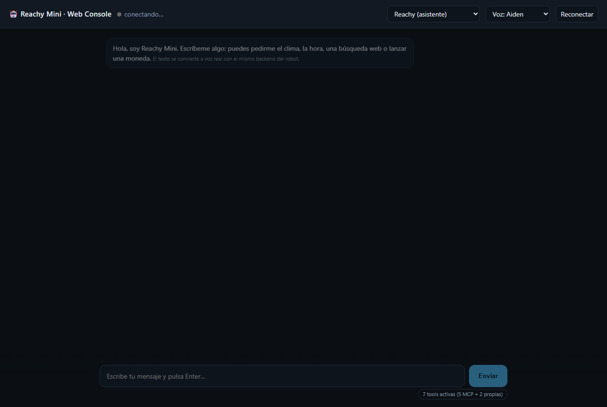

# Reachy Mini · Web Console — proyecto real 🎙️

Consola web que habla con el **mismo backend realtime** que usa el robot Reachy Mini
(Pollen Robotics / Hugging Face), sin robot: texto → LLM con tools → voz TTS real.



## Qué hace

- **Sesión realtime real**: pide sesión al asignador del app
  (`pollen-robotics-reachy-mini-realtime-url.hf.space/session`) y abre el websocket
  OpenAI-Realtime con los 5 Tool Spaces MCP del app.
- **Personalidades auténticas** (del repo oficial): `default`, `mars_rover`
  (rover confundido y sarcástico), `noir_detective` (detective de 1940).
- **Tool-loop real**: 5 MCP Spaces + **14 tools de nuestro Space publicado** +
  **2 tools propias** (`flip_coin`, `roll_dice`).
- **🎤 Habla por micrófono**: PCM16 16 kHz al backend; STT + respuesta hablada en vivo.
- **📷 Visión**: sube una imagen → descripción (VLM) + OCR vía HF Inference API.
- **✍️ Escritura**: lienzo para escribir a mano (el robot lo lee) + tools de notas/documentos.
- **Voz real**: TTS del backend (voz Aiden/Eric/Dylan…) → WAV en el navegador.
- **UI en vivo**: transcripciones, badges de cada tool call, latencia del primer audio.

## Ejecutar

```bash
pip install fastapi uvicorn httpx openai websockets
python server.py
# → http://127.0.0.1:8090
```

Token: `HF_TOKEN` o `hf auth login` (caché de huggingface). Para visión/OCR el token
necesita permiso **«Make calls to Inference Providers»**.

Servicio en segundo plano (Windows):

```powershell
Start-Process -FilePath "python" -ArgumentList "server.py" -WindowStyle Hidden
```

## Prueba sin navegador

```bash
python test_ws.py default "¿Qué tiempo hace en Caracas? Y lanza una moneda."
python test_audio.py "Hola Reachy, ¿qué tiempo hace en Caracas?"    # voz real (edge-tts)
python test_ws.py mars_rover "Hello! What are you? Are we on Mars?"
python test_ws.py noir_detective "Who are you, stranger? And roll a dice."
```

Evidencia real obtenida:

| Personalidad | Mensaje | Tools | Respuesta | Audio | 1er audio |
|---|---|---|---|---|---|
| default | «¿Qué tiempo hace en Caracas? Y lanza una moneda para decidir si salgo con paraguas» | weather + flip_coin | «En Caracas hay algunas nubes y hace 24 grados. Salió **cruz**, así que mejor no lleves paraguas.» | 8.0 s | 2.63 s |
| mars_rover | «Hello! What are you? Are we on Mars?» | — | «I don't know what I am, but please tell me we're on Mars. Where the hell am I?» | 4.6 s | 0.89 s |
| noir_detective | «Who are you, stranger? And roll a dice for luck.» | roll_dice → 4 | «Just a guy looking for a missing clue and a way to pay the rent. A four on the dice, but in this city, luck is just another word for a lie.» | 22.5 s | 0.84 s |

## Arquitectura

```
Navegador ──WS──► server.py (FastAPI) ──► asignador HF ──► websocket realtime
   ▲                 │  tools: 5 MCP Spaces + 2 propias
   └── transcript/audio (WAV b64) / tool events ◄──┘
```

- `server.py` — FastAPI: `/` (UI), `/api/meta`, `/ws/chat?personality=&voice=`
- `static/index.html` — UI (vanilla JS, sin build)
- `test_ws.py` — cliente de prueba (valida ready → tools → transcript → WAV → done)

## Extender

**Tool propia** (equivalente a publicar un Tool Space): en `server.py`, añade el schema a
`CUSTOM_TOOLS` y su ejecución en `execute_tool()`. El LLM la descubre en la siguiente sesión.

**Tool Space remoto nuevo**: publícalo en HF con `launch(mcp_server=True)`, agrégalo a
`MCP_TOOLS` con su nombre namespaced (`owner_space__fn`) y sus parámetros.

**Personalidad nueva**: añade entrada en `PERSONALITIES` (label, voz del backend,
instructions). Aparece sola en el selector de la UI.

## 🔌 MCP propio — publicado en Hugging Face

**Space publicado:** <https://huggingface.co/spaces/Alcides777/reachy-mcp-tool>
**Endpoint MCP:** `https://alcides777-reachy-mcp-tool.hf.space/gradio_api/mcp/schema`

**26 herramientas MCP** (todas sin API key), con datos en vivo, **visión** y **escritura**:

| Tool | Qué hace | Fuente |
|---|---|---|
| `wiki_resumen(tema)` | Resumen de Wikipedia en español | Wikipedia API |
| `clima(ciudad)` | Clima actual + pronóstico | Open-Meteo (real) |
| `monedas(desde, hacia, cantidad)` | Conversión de divisas | Frankfurter/BCE |
| `traducir(texto, destino, origen)` | Traducción | MyMemory |
| `noticias(tema)` | Titulares en vivo | Google News RSS |
| `cripto(moneda)` | Precio USD/EUR + 24h | CoinGecko |
| `deportes(liga)` | Marcadores (laliga, nba…) | ESPN |
| `clasificacion(liga)` | Tabla de posiciones | ESPN |
| `sismos(min_magnitud)` | Última semana | USGS |
| `calidad_aire(ciudad)` | AQI, PM2.5, PM10 | Open-Meteo Air Quality |
| `receta(plato)` | Ingredientes y pasos | TheMealDB |
| `foto_mascota(animal)` | URL de foto de perro/gato | Dog CEO / Cataas |
| `leer_web(url)` | Texto visible de una web | HTTP directo |
| `ocr_imagen(imagen)` | Transcribe el texto de una imagen | VLM (Qwen3.8-27B) |
| `describir_imagen(imagen)` | Describe una imagen | VLM |
| `preguntar_imagen(imagen, pregunta)` | VQA sobre la imagen | VLM |
| **`escribir_nota(titulo, contenido)`** | Escribe una nota en disco | local |
| **`leer_nota(titulo)`** | Lee una nota | local |
| **`listar_notas()`** | Lista notas con fecha/tamaño | local |
| **`borrar_nota(titulo)`** | Borra una nota | local |
| `calculadora(expresion)` | Aritmética segura (AST) | local |
| `convertir_unidades(valor, desde, hacia)` | C°/F°/K°, km/mi, kg/lb, l/gal | local |
| `hora_en(zona)` | Hora en zona IANA | local (tzdata) |
| `curiosidad()` | Dato curioso | local |
| `chiste()` | Chiste corto | local |
| `dado(caras)` | Tirar un dado | local |

**Las 3 vías comparten el mismo núcleo `mcp/tools_impl.py`:**
- `mcp/mcp_server.py` — servidor **MCP real** (JSON-RPC 2.0 por stdio) para Claude Desktop / DSH / Cursor
- `mcp/mcp_http.py` — puente HTTP estilo Gradio para la consola (`:8091`)
- `hf-space/app.py` — el Space publicado (subido con `huggingface_hub`)

**Instalar en el robot real:**
```bash
reachy-mini-conversation-app tool-spaces add Alcides777/reachy-mcp-tool
```

**Probar el protocolo MCP:** `python mcp/selftest.py` (initialize → tools/list → tools/call).

### Evidencia real (el LLM usó 4 tools del Space en un turno)

```text
→ «¿Qué clima hace en Caracas? Convierte 100 USD a EUR, calcula 12*7+3 y cuéntame un chiste.»
🛠️ clima {"ciudad":"Caracas"}        → Caracas, nublado, 22.0°C (máx 30 / mín 20.2), lluvia 27%
🛠️ monedas {"desde":"USD","hacia":"EUR","cantidad":100} → 100 USD = 90.48 EUR (BCE 2026-11-13)
🛠️ calculadora {"expresion":"12*7+3"} → 12*7+3 = 87
🛠️ chiste {}                          → Un robot entra a un bar… «Carga, por favor.»
🔊 «En Caracas está nublado a 22 grados. 100 dólares son 90.48 euros, el resultado es 87…»
   14.5 s de audio real
```

### Evidencia real #2 — datos en vivo (4 tools nuevas en un turno)

```text
→ «Dame las noticias de hoy sobre robots humanoides, el precio del bitcoin,
   los partidos de LaLiga y los sismos recientes de magnitud 4 o más.»
🛠️ noticias {"tema":"robots humanoides"} → «Un robot ejerce de guía por el Museo Jurásico…» (14 Nov)
🛠️ cripto {"moneda":"bitcoin"}            → bitcoin: 64,643 USD · 58,640 EUR (-3.97% 24h)
🛠️ deportes {"liga":"laliga"}             → Athletic Club 0 vs Espanyol 0 — Scheduled
🛠️ sismos {"min_magnitud":4}              → M6.4 Solomon Islands, M5.8 Peru, M5.8 PNG…
🔊 «…El Bitcoin está a 64,643 dólares… sismos fuertes en Islas Salomón y Perú.»  [16.6 s]
```

## 🖥️ UI del Space

El Space incluye **UI navegable** (una pestaña por tool + catálogo), así que además de
servir como MCP remoto se puede probar cada herramienta desde el navegador:
<https://huggingface.co/spaces/Alcides777/reachy-mcp-tool>

## 🎙️ Micrófono en vivo (voz → PCM16 → backend realtime)

El navegador captura con `getUserMedia` + `AudioContext` (con AEC), **remuestrea a 16 kHz**
y envía trozos PCM16 por el WebSocket (`{"type":"audio"}`). El servidor los pasa a
`input_audio_buffer.append` y el backend hace el resto:

**`server_vad`** (modo del robot) → detecta el habla y el silencio, transcribe y responde solo.

```
🎤 STT → «Richy, ¿qué hora es en Tokio y cuál es el precio del Bitcoin?»
🛠️ hora_en {"zona":"Asia/Tokyo"}   🛠️ cripto {"moneda":"bitcoin"}
🔊 «En Tokio son las doce trece y el Bitcoin está a sesenta y cinco mil cuatrocientos
   veintiuno dólares.»   [audio 8.3 s · 1er audio 2.54 s]
```

**Prueba sin micrófono** (sintetiza voz real con `edge-tts` → ffmpeg → PCM16):

```bash
pip install edge-tts
python test_audio.py "Hola Reachy, ¿qué tiempo hace en Caracas?"
```

## 📷 Visión / OCR — también como **tools MCP**

Las 3 tools de visión están en el núcleo compartido (MCP local, puente y Space):

| Tool | Qué hace |
|---|---|
| `ocr_imagen(imagen)` | Transcribe el texto de una imagen (URL o base64) |
| `describir_imagen(imagen)` | Describe la imagen en una frase |
| `preguntar_imagen(imagen, pregunta)` | Responde preguntas sobre la imagen (VQA) |

### Evidencia real — el LLM usa las tools de visión

Imagen subida a la consola (`/api/vision/upload` → URL temporal) y el modelo elige las tools:

```text
→ «Analiza la imagen: dime qué es y transcribe exactamente el texto…
   La imagen está en: http://127.0.0.1:8090/tmpimg/eef2…»
🛠️ describir_imagen {"imagen": "http://127.0.0.1:8090/tmpimg/eef2…"}
    ↳ Texto negro que dice "REACHY MINI 2026" sobre fondo blanco.
🛠️ ocr_imagen {"imagen": "http://127.0.0.1:8090/tmpimg/eef2…"}
    ↳ REACHY MINI 2026
🔊 «Es una imagen con fondo blanco y el texto dice exactamente REACHY MINI 2026.»
```

### En el Space publicado (URL pública)

```text
describir_imagen(URL)                 → «Dos gatos tigrados descansan sobre un montón de redes de pesca.»
preguntar_imagen(URL, "¿cuántos gatos?") → «Hay 2 gatos en la imagen…»
```

**UI:** botón **📷** → sube imagen → te pregunta qué quieres saber → la analiza el LLM
con las tools y responde por voz.

**Vía API directa** (más rápida, sin LLM): `POST /api/vision/ocr` y `/api/vision/caption`.

### Cómo funciona

Los endpoints por bytes (`/hf-inference/models/...`) **ya no sirven modelos de imagen**
(400 "Model not supported by provider"). La vía correcta en 2026 es **chat completions
multimodal** del router:

```
POST https://router.huggingface.co/v1/chat/completions
  model: Qwen/Qwen3.8-27B   (fallback: google/gemma-4-31B-it, moonshotai/Kimi-K3)
  messages: [texto] + [image_url: data:image/png;base64,…]
```

- `vision.py` → `ocr(image)` y `caption(image)` (imagen en bytes)
- `mcp/tools_impl.py` → `ocr_imagen/describir_imagen/preguntar_imagen` (imagen por URL/base64)
- En el Space, el secret `HF_TOKEN` (Inference Providers) ya está configurado.

Requiere token con **«Make calls to Inference Providers»** en
`HF_TOKEN` o `~/.cache/huggingface/token`.

## 🧯 Solución de problemas (UI)

| Síntoma | Causa | Arreglo |
|---|---|---|
| «desconectado — reconectando…» | el servidor se reinició (o se cayó la sesión) | la UI **se reconecta sola en 2 s** (antes había que pulsar Reconectar) |
| El 🎤 no hace nada | no conectado, o hay una respuesta en curso | ahora muestra el motivo exacto; espera la respuesta y reintenta |
| El texto está bloqueado | igual: sin conexión o turno en curso | ahora avisa «aún no estoy conectado» / «espera la respuesta» |
| Página con la UI vieja | caché del navegador | el servidor envía `Cache-Control: no-store`; recarga con **Ctrl+Shift+R** |
| Micrófono denegado / no disponible | contexto no seguro o permiso bloqueado | abre siempre `http://127.0.0.1:8090` (o `localhost`), no la IP de LAN |

**Verificación automática de la UI** (navegador real por CDP, con micrófono simulado):

```bash
python ui_check.py
# estado: lista · default · Aiden | ws: 1 | mic: grabando | sin excepciones
```

## 🤖 Simulación del robot (daemon mockup) — app completa sin hardware

El SDK de Reachy Mini trae un **daemon en modo simulación** que hace que la app
conversacional funcione completa (motion loop 60 Hz, audio, tool-calling, realtime) **sin robot**:

```powershell
# 1) daemon en modo mockup (sin MuJoCo)
.\.venv\Scripts\reachy-mini-daemon.exe --mockup-sim --headless --log-level INFO

# 2) app conversacional (en otra terminal / venv)
.\.venv\Scripts\reachy-mini-conversation-app.exe --no-camera
```

Evidencia real (16:47 local):

```text
Connection mode selected: localhost_only → Auto-detected local IPC endpoint. Using LOCAL backend.
Using Hugging Face realtime handler (Hugging Face session proxy)
Loading tools for profile: default → Found 38 tools to load
  ✓ Loaded core tool: dance / move_head / camera / remember / robot_status …
  ✓ Registered remote tool: Alcides777_reachy_mcp_tool__clima
  ✓ Registered remote tool: Alcides777_reachy_mcp_tool__ocr_imagen
  … (17 de nuestro Space)
Allocated realtime session SITbfQHHr6u6MU4jdNt-NCz9
Realtime session initialized with voice='Aiden'
Assistant transcript: Hello there! What can I help you with today?
```

> En mockup el daemon avisa de que no encuentra la tarjeta de audio del robot
> (`No Reachy Mini Audio USB device found`) y usa el audio por defecto: es normal.

## ✍️ Escritura: lienzo a mano + notas

Además de 🎤 voz y 📷 imagen, la consola tiene **✍️ escritura**:

**1) Lienzo a mano** — pulsas ✍️, escribes con el ratón/dedo y el robot lo lee con su tool de OCR
(la imagen se sube a `/api/vision/upload` y el LLM recibe la URL).

**2) Tools de notas** — el asistente puede **escribir, leer, listar y borrar** notas en disco
(`~/reachy_notas/*.md`), útiles para "apunta esto", "léeme lo que apunté", etc.

Prueba real (navegador headless, CDP):

```text
[1] consola: lista · default · Aiden
[2] panel abierto: True
[4] pixeles con tinta: 28168
[5] enviado; esperando respuesta del LLM…
[6] respuesta: «El texto dice: "Reachy 2026, voz + vision + escritura".» · 1 tool(s) · 1er audio 3.22s
```

Y las notas vía LLM:

```text
→ «Apunta una nota titulada 'Pruebas robot' con el contenido: voz, visión y escritura funcionan.»
🛠️ escribir_nota {"titulo":"Pruebas robot","contenido":"voz, visión y escritura funcionan"}
    ↳ Nota guardada: C:\Users\Alcides\reachy_notas\Pruebas_robot.md
🔊 «Listo! Ya he guardado la nota Pruebas robot.»
```

Verificación del lienzo: `python ui_canvas_check.py`.

## 🔌 Modos de conexión (selector en la UI)

| Modo | Motor | Sesión HF | Latencia | Cuándo usarlo |
|---|---|---|---|---|
| **☁️ HF realtime** | asignador + WebSocket de HF | sí (1 por conexión) | ~0.7 s al primer audio | voz premium, barge-in |
| **💻 Local** | **Whisper** (ASR) + **Qwen3.8-27B** (LLM con tools, HF Router) + **edge-tts** (voz es-ES) | **no** | ~5–8 s por turno | sin límites de sesión, sin 429 |

El modo local **no toca el asignador**, así que el `429 behavior_cooldown` no puede ocurrir.
Todo va por HTTP con el token HF que ya tienes; no descarga modelos ni necesita GPU.

**Prueba real (UI, navegador headless):**
```text
[1] modo: local | estado: modo local listo · Whisper + Qwen + edge-tts
[3] respuesta: «En Madrid son las 00:43 del 16 de noviembre de 2026. Y un chiste:
    ¿Qué le dice un bit a otro? ¡Nos vemos en el bus!» · 2 tool(s) · 6.99 s
```

**Prueba por API (texto y audio):**
```text
texto  → tools=['hora_en','dado']        reply: «En Tokio son las 08:41… 🎲 ha salido un 3»   (6.4 s)
audio  → STT «apunta una nota… hola mundo» · tool=escribir_nota · nota guardada              (31.9 s)
```

Verificación: `python ui_local_check.py`. Endpoint: `POST /api/local/turn`
(`{text}` o `{audio}` base64 → `{transcript, reply, tools, audio, latency_ms}`).

## ⚡ Latencia del modo local (streaming + caché + TTS local)

Optimizaciones aplicadas (medidas reales en esta máquina, Intel N100):

| Optimización | Efecto |
|---|---|
| **TTS local con Piper** (es_ES-davefx-medium / en_US-lessac-medium) | **~0.6 s por frase**, sin red ni límites |
| **LLM en streaming (SSE)** | el texto y el audio aparecen mientras se genera |
| **TTS por frase en paralelo** | la 1ª frase suena antes de que termine la respuesta |
| **Tools en paralelo** | 2–3 tools en el mismo tiempo que 1 |
| **Caché de TTS en disco** | frases repetidas suenan al instante (`~/reachy_tts_cache`) |
| **Frase de relleno** («Un momento…», cacheada) | suena si las tools tardan |
| **Modelo elegido por TTFT** | Qwen3.8-27B **0.42 s** (Kimi 0.70 s; Gemma 13 s, descartado) |
| **Warm-up al arrancar** | Piper cargado + rellenos pre-sintetizados |

### Comparativa de motores TTS (misma frase, esta CPU)

| Motor | Tiempo por frase | Notas |
|---|---|---|
| Kokoro ONNX int8 | 3 – 8 s | demasiado lento en N100 (descartado) |
| edge-tts (red) | ~1.3 s | gratis, requiere internet |
| **Piper ONNX (local)** | **~0.6 s** | ✅ elegido; sin red |

### Antes vs después (mismo tipo de pregunta)

| Caso | Antes (sin streaming) | Con streaming | **Con Piper** |
|---|---|---|---|
| Sin tools | 6.4 s | 2.6 s (1er audio 2.3 s) | **2.6 s (1er audio 1.2 s)** |
| Con 2–3 tools | ~7 s sin audio | 5.6 s (1er audio 4.7 s) | **2.0 s (1er audio 2.0 s)** |

Modelos en `~/reachy_models/` (≈240 MB). Volver a edge-tts: `set REACHY_TTS=edge`.
Verificación: `python test_local_stream.py "Dime la hora en Tokio y un chiste."`

## ⏹ Interrumpir la voz (barge-in)

Mientras el robot habla puedes cortarlo de tres formas:

| Acción | Efecto |
|---|---|
| Pulsar **⏹** (aparece solo mientras suena) | corta el audio y vacía la cola |
| Tecla **Esc** | lo mismo |
| Pulsar **🎤** | corta la voz y empieza a grabarte |

Se muestra la burbuja «⏹ (interrumpido)». Verificado: `python ui_stop_check.py`

```text
[1] botón ⏹ existe: True      [2] oculto al inicio: none
[3] visible mientras suena: block   [4] oculto tras parar: none
[5] burbuja: ⏹ (interrumpido)  [6] tras Escape: none
```

## 🩺 Doctor — chequeo de salud

```bash
python doctor.py
```

Comprueba servicios (8090/8091/8000/7860), token HF, LLM del router, **TTS Piper en
caliente**, caché, notas, tools, puente MCP y el Space publicado, y sugiere qué arrancar:

```text
 ✅ Consola web       puerto 8090      ✅ Token HF Alcides777 (pro=True)
 ✅ LLM (HF router)   Qwen3.8-27B · 0.45s
 ✅ TTS Piper (local)  51244B en 1.11s (caliente)
 ✅ Caché TTS  94 archivos · 14.86 MB   ✅ Tools del MCP 26 tools
 ✅ Space HF (MCP) 26 tools · despierto
 12 comprobaciones · 1 fallos (app 7860 parada) · 18.9s
```

## ☁️ Desplegada en la web (Space Docker de Hugging Face)

**Consola online:** <https://huggingface.co/spaces/Alcides777/reachy-web-console>
**URL de la app:** `https://alcides777-reachy-web-console.hf.space` (privado: requiere sesión HF)

Se despliega como **Space Docker** (`Dockerfile`, `app_port: 7860`) con el secret
`HF_TOKEN` (Inference Providers) configurado. El contenedor:
- instala `fastapi/uvicorn/openai/websockets/edge-tts/piper-tts` + `ffmpeg`
- descarga los modelos **Piper** al arrancar (ES + EN) y calienta la caché TTS
- sirve la misma UI (voz · visión · escritura · barge-in) y los modos HF/local

Prueba real desde la web (Space recién desplegado):

```text
[1] GET /              → 200 · UI servida
[2] /api/meta          → 33 tools
[3] /api/local/cache   → {"archivos":6,"mb":0.31,...}
[4] turno local (SSE):
    🛠️ hora_en · 🛠️ chiste
    🔊 1ª frase a 1215 ms: «Son las 10:38 en Tokio.»
    ✅ total 1327 ms · 1er audio 1215 ms
```

Verificación: `python test_web_space.py` (usa el token de tu caché).

**Para compartir la URL con otras personas** hay que hacer el Space **público**
(Settings → Change visibility). Nota: usa tu cuota de Inference con el token del secret.
Alternativa sin Space: `cloudflared tunnel --url http://127.0.0.1:8090` (rápido, pero
necesita tu PC encendido).

## 🚦 Error 429 del asignador de sesiones (rate limit de HF)

El endpoint `pollen-robotics-reachy-mini-realtime-url.hf.space/session` limita por
solicitante. Si se crean muchas sesiones (pruebas, reinicios, varias pestañas, app y
consola a la vez) responde:

```json
{"detail":{"code":"requester_rate_limited","reason":"behavior_cooldown","retry_after_s":672}}
```

**Qué hace ahora la consola:**
- Lee `retry_after_s` y guarda un **cooldown global** (no vuelve a llamar a HF hasta que expire)
- Avisa en la UI con el tiempo de espera y **se reconecta sola** al terminar
- Las pestañas que reconectan respetan el cooldown (no martillean)

Comprobar: `python test_429.py` → la 2ª conexión responde en ~0 s sin llamar a HF.

**Buenas prácticas para no provocarlo:**
1. **Una sesión a la vez**: app del robot (7860) **o** consola (8090), no ambas
2. No dejar varias pestañas abiertas reconectando
3. No reiniciar los servicios en bucle (cada reinicio = nueva sesión)
4. Si ya está limitado: esperar el `retry_after` (suele ser 2–12 min) y recargar

## ⏰ Mantenimiento (keepalive)

El Space duerme tras 48 h sin tráfico (hardware gratis). Para que esté siempre listo:

| Mecanismo | Cuándo | Depende de | Repo |
|---|---|---|---|
| **GitHub Actions (nube)** | cada **12 h** (06:00/18:00 UTC) | nada — corre en GitHub | [reachy-mcp-keepalive](https://github.com/Alcides777venezuela/reachy-mcp-keepalive) |
| DSH scheduled task | cada **18 h** | este PC + DSH abierto | `schedule-7e07c51c` |

El cron de GitHub hace `GET` al schema, despierta el Space si está dormido (abre su página y
reintenta 3×) y publica el resumen en el run. Cada 7 días hace un commit pequeño para evitar
el auto-disable de cron de repositorios públicos.

Verificado: run [43669559424](https://github.com/Alcides777venezuela/reachy-mcp-keepalive/actions/runs/43669559424)
→ `intento 1 → HTTP 200` · `✅ MCP OK — 14 tools` · success.

## Notas

- El backend realtime es el servicio real del app: cada conexión asigna una sesión
  (máquina virtual de inferencia). No se necesita robot, pero sin robot no hay micrófono
  ni movimientos: la voz se recibe como audio y se reproduce en el navegador.
- El Space público de búsqueda depende de su proveedor interno; a veces devuelve pocos resultados.
